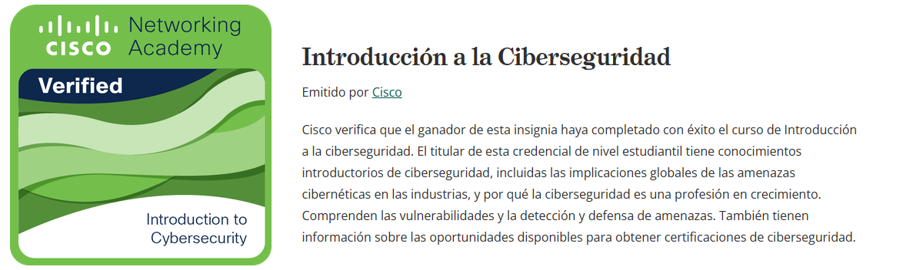
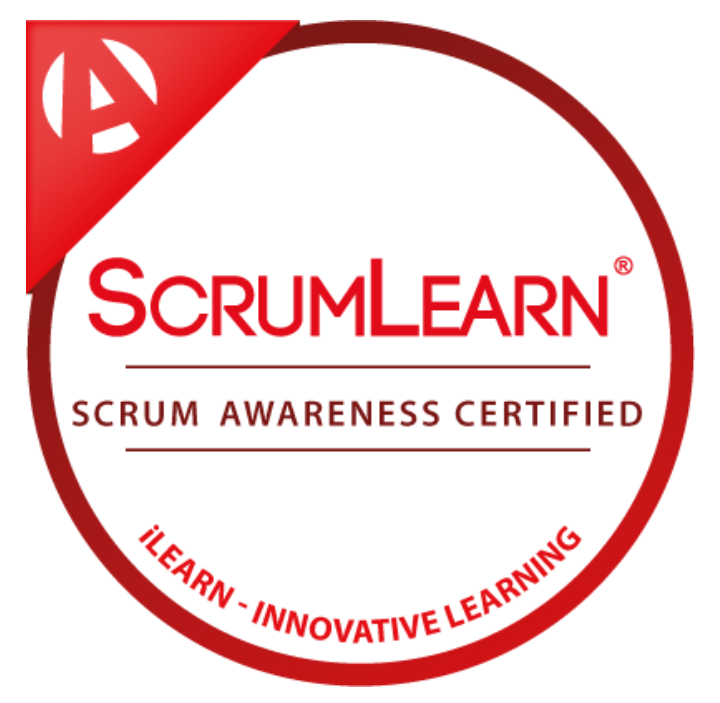
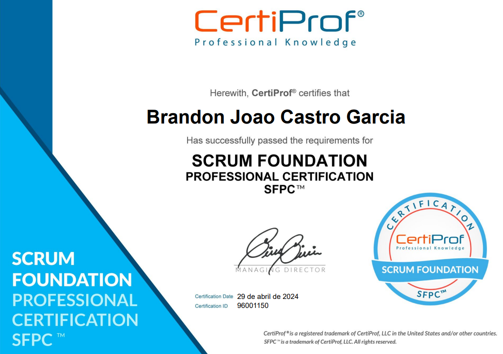

# Hola👋

Desempeñándome en el area de desarrollo como Desarrollador FullStack para Laila Tecnología LEgal, estudiante de ultimo año Ing informática, por ahora me centro en proyectos personales y aprendiendo distintas tecnologías. 

### 🏅 Certificate 🏅

#### [Ciber seguridad](https://www.credly.com/badges/4aff4e78-b237-4d11-9f68-e66d188589e9)

#### [Scrum Learn Awareness](https://badges.innovativelearning.eu/badge/35d436e7-e7cc-43f7-8016-433fd92f798e)

#### [Scrum Foundation Professional Certification](https://www.credly.com/earner/earned/badge/10c8b812-a3f9-4608-ab50-d4618544afd8)

<!--
**BranCG/BranCG** is a ✨ _special_ ✨ repository because its `README.md` (this file) appears on your GitHub profile.

Here are some ideas to get you started:

- 🔭 I’m currently working on ...
- 🌱 I’m currently learning ...
- 👯 I’m looking to collaborate on ...
- 🤔 I’m looking for help with ...
- 💬 Ask me about ...
- 📫 How to reach me: ...
- 😄 Pronouns: ...
- ⚡ Fun fact: ...
-->
